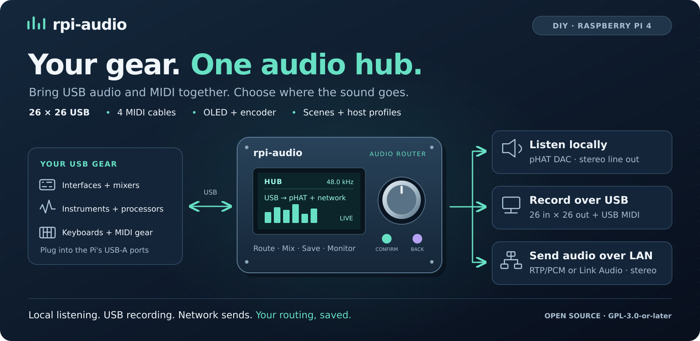
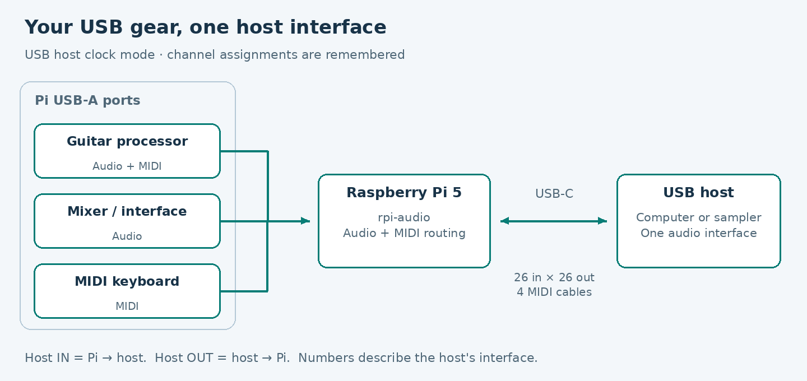
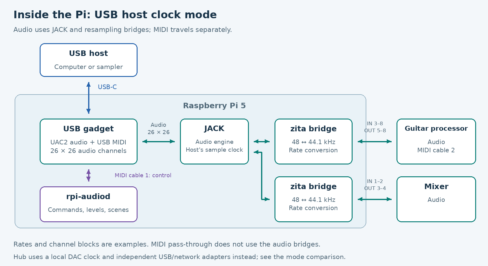

# rpi-audio

[](docs/MANUAL.md)

[](https://github.com/trak3r-os/rpi5-audioface/actions/workflows/ci.yml)
[](LICENSE)
[](https://github.com/trak3r-os/rpi5-audioface/commits/main/)
[](https://github.com/trak3r-os/rpi5-audioface/issues)
[](https://github.com/trak3r-os/rpi5-audioface/stargazers)

[](docs/MANUAL.md#16-build-your-own-device)
[](docs/MANUAL.md#6-record-over-usb)
[](docs/MIDI.md)
[](docs/MANUAL.md#12-network-audio)
[](docs/MANUAL.md#ableton-link-audio)
[](docs/MANUAL.md)

**Topics:** [raspberry-pi](https://github.com/topics/raspberry-pi) · [usb-audio](https://github.com/topics/usb-audio) · [midi](https://github.com/topics/midi) · [jack-audio](https://github.com/topics/jack-audio) · [network-audio](https://github.com/topics/network-audio) · [rtp](https://github.com/topics/rtp) · [ableton-link](https://github.com/topics/ableton-link) · [diy](https://github.com/topics/diy)

CI runs only when a GitHub release is published. Pushes, pull requests and draft-release edits do not start it. The Release CI badge tracks release runs.

**A Raspberry Pi 5 (or 4) that works as a USB audio hub.** Plug your USB sound cards, guitar processors, mixers and MIDI gear into the Pi, and plug the Pi into a computer or a standalone sampler. The host sees one class-compliant USB audio interface, **26 in × 26 out at 44.1 kHz, 16-bit by default**, plus **4 USB MIDI ports**. Each device gets its own channels.

**New to the box?** Start with the [illustrated English user guide](docs/MANUAL.md), readable directly on GitHub. An [HTML edition](docs/manual/index.html) with the same illustrated steps is included for a browser or GitHub Pages; GitHub's file viewer displays HTML source. The guide covers USB recording, standalone pHAT listening, controls, meters, simultaneous outputs, network audio and scenes.

**Building your own?** The [build guide and bill of materials](docs/MANUAL.md#16-build-your-own-device) lists quantities, required and optional parts, power/data connections, GPIO wiring, assembly, installation and first checks. It distinguishes the tested hardware from untested substitutes.

The OLED now opens on Overview and includes connection notices, live peak meters and channel/MIDI mappings. **Hub mode combines pHAT, USB host and network outputs** with a continuous local clock. Install network adapters with `sudo ./install.sh --network`, then select Outputs → Audio mode → Hub. RTP/PCM offers an SDP download at `http://PI-IP:8080/network-rtp.sdp`; Link Audio uses Ableton’s official SDK. Both network outputs start disabled. See [implementation and test limits](docs/OUTPUTS.md) and [project research](docs/NETWORK_RESEARCH.md). Network input and full AES67 are not implemented.

Host profiles can save reservations only, an independent full setup including names, or a link to one of the eight scenes. Use Outputs → Host → Save current as..., or `rpi-audiod host save NAME full`. User profiles survive deployments in hosts.json and local audio-group users can save them without sudo. See the [host-profile steps](docs/MANUAL.md#save-and-choose-a-host-profile).

Profiles now report Ready/Partial/Error with missing-resource details. Outputs offers independent software levels for pHAT, USB-host send, RTP and Link Audio. Status includes session-wide counters and a bounded event history collected while the OLED sleeps, retained across service restarts during the same boot.



It was built for the Akai Force, which can use only one USB audio interface at a time. Nothing in it is tied to the Force: any host that supports USB Audio Class 2 should work. It has been tested with a Linux laptop and an Akai Force. Anything specific to one host lives in `docs/hosts/` and `tools/hosts/`.


*The optional rpi-audio Panel inside MPC on an Akai Force. It shows each device plugged into the Pi, its channels on the interface, its levels and mutes, and the 8 routing presets.*

## What it does

- **One interface for many devices.** Every USB audio device on the Pi shows up as a block of channels on the one interface the host sees.
- **Sticky channels.** Each device keeps its block of channels. A device that comes back after a reboot or a re-plug gets the same slot, so your host project keeps working.
- **Names, levels, mutes and presets.** You can name devices and channels, set each device's level, mute it, and save up to 8 routing presets.
- **MIDI goes through too.** The MIDI ports of the devices on the Pi reach the host over the gadget's MIDI cables, in both directions.
- **Control from the host over USB.** One MIDI cable is a control port that takes SysEx text commands, CCs and Program Changes. No network and no app needed.
- **USB budget check.** The Pi's USB-A ports can carry only a few full-speed audio devices at once. `rpi-audiod` works out each device's load before opening it and tells you when one does not fit.
- **Runs without a screen.** Everything starts at boot, and `rpi-audiod doctor` checks the installation.

## How it works

The diagram and clock description below show the original **USB host clock** mode. In **Hub**, JACK instead runs continuously on the local DAC at 48 kHz; separate USB bridges follow the host's rates, and local, USB and network destinations can run together. **Standalone** uses the local clock without the USB audio bridge. See the [mode comparison](docs/MANUAL.md#1-what-the-box-does).



1. **The USB gadget.** The Pi's USB-C port can act as a USB *device*. `gadget/` sets up a standard USB Audio Class 2 function and a USB MIDI function through configfs, so the host uses its built-in drivers.
2. **One clock.** JACK runs on the gadget, so the Pi follows the host's sample clock. Each USB device has its own clock, and often its own rate (48 kHz is common). For each device, `rpi-audiod` starts one bridge per direction that resamples on the fly to keep it in step. Since 2026-11-17 these are native bridges too (`rpi-audio-hostbridge`, below), with 1 ms of buffer on capture and 2 ms on playback; `[bridge] mode = "zita"` goes back to zita-ajbridge, which is also used when the native program is not built.
   - **The USB host side.** Since 2026-11-14, in Hub mode, the 26-channel link to the host uses a native bridge, `rpi-audio-hostbridge`, instead of zita. It talks to the gadget's ALSA device directly, resamples all 26 channels in one pass and follows the host's pace. It adds about 5 ms less delay and uses about a quarter of the CPU (numbers in [Performance](#performance)). `host_bridge = "zita"` in the configuration goes back to zita, and zita is also used when the native program is not built.
3. **rpi-audiod** watches devices come and go and gives each one its block of gadget channels. It starts and stops the bridges, applies levels and mutes, and saves and loads presets. It also keeps the host fed, with silence if nothing else, because some hosts (the Akai Force) reset when the interface goes quiet while they stream.
4. **MIDI.** Each MIDI port of a device gets a gadget cable of its own, through kernel sequencer connections. Cable 1 goes to `rpi-audiod` as the control port.

The control port is how a host, or the panel shown above, talks to the Pi:


The full protocol is in [docs/MIDI.md](docs/MIDI.md).

## What you need

For the complete DAC/OLED/encoder build, use the [parts list with quantities and assembly instructions](docs/MANUAL.md#16-build-your-own-device). The short list below covers the USB hub itself.

- A **Raspberry Pi 5** with its official power supply. This is the reference board since 2026-11-07, and all the measurements in [Performance](#performance) are from it. A **Raspberry Pi 4** takes the same SD card and install and was the original platform; its numbers are older and some are marked as Pi 4.
  - **Active cooling is recommended on a Pi 5.** With no fan it ran at 72–76 °C idle with the bridges and 79–81 °C with a host streaming, and the firmware starts cutting the clock at 80 °C. With a fan (the Pi 5's official Active Cooler, or any fan on its fan header) the same load stays at about 50 °C. See [Performance](#performance).
  - On a Pi 5 whose supply does not negotiate 5 A over USB-PD (a 3 A supply, or any supply behind the splitter), the firmware limits the USB-A ports to 600 mA in total. Power hungry devices then need their own supply or a powered hub.
- A **USB-C data/power splitter**. We use the "USB-C/PWR Splitter" from 8086 (8086.net/p/usbcs). The Pi 4 and the Pi 5 each have only one USB-C port, and it is both the power input and the gadget (device-mode) port. The splitter lets you feed power from the supply and send data to the host over separate connectors. Wiring we used: supply to POWER, DATA POWER to the Pi, USB2 DATA to the host.
- The USB audio and MIDI devices, on the Pi's **USB-A** ports.
- A host with a USB port. Connect the Pi directly, not through a hub.

### The full-speed USB budget

The Pi 4's USB-A ports share one controller with a limited budget for periodic (isochronous) traffic from **full-speed** devices. We measured the controller accepting 1099 bytes per frame and refusing about 1270 [Pi].

| Device type | Cost | In practice |
|---|---|---|
| High-speed (most modern interfaces, e.g. the Valeton GP-150) | 0 | Does not count against the budget |
| Full-speed, stereo (cheap USB sound cards, mixers with a PCM2902) | about 200–400 bytes per frame | About one medium device fits on a Pi 4 |
| Full-speed with many channels (e.g. a Tracker in "10 OUT / 2 IN") | over 1000 bytes | Does not fit next to anything else |

`rpi-audiod` works out each full-speed device's load before opening it, and counts the budget per **root port**: the port on the Pi a device is plugged into, with everything behind a hub on that port sharing it. If a device does not fit, it waits and `rpi-audiod status` says why. Details are in `docs/PLAN.md`.

The same controller (a VIA VL805) also **drops packets from full-speed multichannel inputs**. It happens whenever a packet exactly fills the buffer the controller was given for it: a Tracker sending 8 channels lost about one packet in 150. On a Pi 4, `install.sh` therefore installs a small kernel module, `fs_isoc_pad` (`tools/kernel/fs-isoc-pad/`). It adds one byte to the maximum packet size the host uses for those inputs.
- **What changes:** each card behind the VL805 disappears and comes back once when it is plugged in.
- **Install:** the module is built with DKMS, which installs `dkms` and the kernel headers when they are missing and rebuilds it after kernel updates.
- **Measured** [Pi]: 0 lost packets in 10 minutes at 8 and at 10 channels.

Details are in `docs/hw/2026-11-04-pi-usb-host.md`.

The **Pi 5** has no VL805: its USB-A ports hang off two USB host controllers in its RP1 chip, with no hub in between, so each port gets its own budget. A Tracker sending 8 channels (720 bytes) and a stereo mixer (388 bytes) on two ports of the same controller ran for 60 seconds without a single bad packet [Pi]. On the Pi 4 the budget was shared, because all its ports sit behind one internal hub. The 1099-byte figure per port was measured on the Pi 4 and has not been checked on a Pi 5. `install.sh` does not install `fs_isoc_pad` there.

## Install on the Pi

Use Raspberry Pi OS, 64-bit. The tested system is Debian 13 (trixie) with kernel 6.18. The Pi does not need PipeWire: rpi-audio uses JACK.

```sh
git clone https://github.com/trak3r-os/rpi5-audioface.git
cd rpi5-audioface
sudo ./install.sh                  # gadget + rpi-audiod, started at boot
sudo ./install.sh --host akai-force   # the same, with the Akai Force profile
sudo reboot                        # only if the installer enabled the USB gadget overlay
```

Run only one of the two `install.sh` lines. Use `--host akai-force` if the host is an Akai Force, and the plain line otherwise.

| Option | What it does |
|---|---|
| `--host NAME` | Also installs the profile for that host from `tools/hosts/` |
| `--no-enable` | Does not change what starts at boot |
| `--force-config` | Overwrites `/etc/rpi-audio/*`. By default existing files are kept, and the new versions are written next to them as `*.new` |
| `--no-boot-config` | Does not add `dtoverlay=dwc2,dr_mode=peripheral` to the boot configuration |
| `--tune-boot` | Also tunes the boot for audio: `threadirqs` in `cmdline.txt` and `dtparam=audio=off` (the Pi's own analogue audio) in `config.txt`, each with a backup. Only with this option; it takes effect after a reboot |
| `--read-only` | Appliance mode, off by default: the root file system becomes a RAM overlay (`overlayroot`, the same change as `raspi-config`'s overlay file system), the boot partition is mounted read-only, and the saved state is kept on the boot partition. Power can then be cut without corrupting the root. Backs up what it edits, takes effect after a reboot, and prints how to undo it. See [the guide](docs/MANUAL.md#read-only-appliance-mode) |
| `--hw-watchdog S\|off` | Sets the hardware watchdog timeout (5 to 300 seconds) or turns it off. Raspberry Pi OS already arms it at 1 minute. A watchdog reset skips the gadget's orderly shutdown; see [the guide](docs/MANUAL.md#watchdogs) |
| `--volatile` | Installs into an active RAM overlay anyway; the change is gone at the next reboot |
| `-y` | Does not ask before adding the gadget overlay |

The installer also enables `rpi-audio-cpu.service`, which keeps the CPU governor at `performance` so the audio threads do not wake up on a slowed clock. `sudo systemctl disable --now rpi-audio-cpu` goes back to `ondemand`.

It also masks apt's daily timers (`apt-daily.timer` and `apt-daily-upgrade.timer`). They start downloads and upgrades at random times, and that load can make the host bridge skip. The Pi then no longer updates itself: run `sudo apt update && sudo apt full-upgrade` by hand when no host is playing. `--uninstall` unmasks them.

To update, run `git pull && sudo ./install.sh`. To remove it, run `sudo ./install.sh --uninstall`. Add `--purge` to also delete the settings and the saved state.

The gadget is created once at boot by `rpi-audio-gadget.service`. Do not unbind and rebind it in a loop: repeated rebinds can lock up the Pi's USB controller.

### Gadget settings

`/etc/rpi-audio/gadget.env` sets the interface the host sees. After changing it, run `sudo systemctl restart rpi-audio-gadget` once.

| Setting | Default | Meaning |
|---|---|---|
| `GADGET_CHANNELS` | 26 | Channels in each direction |
| `GADGET_SRATE` | 44100 | Sample rate. The Akai Force only accepts 44100 |
| `GADGET_SSIZE` | 2 | Bytes per sample (2 = 16-bit) |
| `GADGET_MIDI_PORTS` | 4 | USB MIDI ports per direction. 0 turns MIDI off |
| `GADGET_PRODUCT` | `rpi-audio` | Name the host shows |

Never put "UAC2_Gadget" in the product name: MPC ignores cards with that name.

## Connect a host and check

1. Plug the splitter's data side into the host.
2. On the Pi, run:

   ```sh
   rpi-audiod doctor     # the installation and the Pi: controller, services, governor, power, PipeWire
   rpi-audiod status
   ```

   `doctor` prints one line per check and exits with an error if something is broken. `status` shows the gadget, the connected devices, their channel blocks, levels, names and presets.
3. On the host, look for an audio interface and MIDI ports called **rpi-audio**.

What has been tested:

| Host | Result |
|---|---|
| Linux laptop | 26×26 at 16-bit: bit-exact tones in both directions; 10-minute duplex soak with no xruns; USB MIDI, SysEx and CC control |
| Akai Force | MPC opens it at 26×26, 16-bit. 60-minute duplex soak with 0 xruns and 0 underflows, and MIDI control from an MPC track (Pi 4, zita bridge). On a Pi 5 with the native bridge and a fan: 62-minute soak with a Tracker and a mixer attached, 0 xruns and 0 resyncs, and MPC kept its stream open. Round trip through MPC: 12.4 ms (see [Performance](#latency-akai-force-as-the-host)). Nobody has listened for clicks yet |
| macOS | Not tested |
| Windows | Not tested. Windows' class driver (`usbaudio2.sys`) is documented to limit shared mode to 8 channels, so expect to need exclusive mode or ASIO, or a lower channel count |

The Akai Force needs the Pi to be playing into the gadget whenever the host streams, even silence. Otherwise MPC resets or drops back to its internal audio. `rpi-audiod` does this for you, so run it (it starts at boot).

## Performance

All of this was measured on a **Raspberry Pi 5** [Pi], with a fan unless it says otherwise. Numbers are medians or maxima of the runs in `docs/hw/`; the sessions say how each was taken.

### Latency (laptop as the host)

The Pi's share of the round trip (audio in from the host, through the Pi, and back to the host), measured with `jack_iodelay` on a Linux laptop that has no real-time scheduling. **Absolute values are good to about ±2 ms; the differences between rows are the robust part.**

| USB host bridge | Pi share, median | Range |
|---|---|---|
| Host-clock mode (no resampling) | 5.5 ms | 2.6–15.9 ms |
| Native, 0.5 ms margin | 5.1 ms | 4.4–6.8 ms |
| Native, 1.0 ms margin | 7.8 ms | 6.0–8.9 ms |
| **Native, 1.5 ms margin (default)** | **8.6 ms** | 6.7–11.1 ms |
| zita | 14.8 ms | 13.6–18.6 ms |

- The native bridge at the default margin takes **5–6 ms off** zita's round trip, and sits about 1.5–3 ms above host-clock mode. The two methods in the session agree: 6.5 ms against 11.7 ms for zita by the first, 8.6 against 14.8 by the second.
- The bridge reports its delay to JACK: 107 frames on the capture side and 104 on the playback side, so JACK's latency queries include it.
- **Margin.** Below 1.5 ms the laptop saw 1–4 resyncs per 12-second open, for a reason that is not known. With the Akai Force as the host the 0.75 ms margin ran 10.5 minutes with 0 resyncs, which points at the laptop rather than the bridge, but that is a single run. 1.5 ms stays the default.
- **JACK on the pHAT DAC at 64×3** (1.3 ms) ran 3 minutes with 0 xruns and the fan on. Without the fan it gave 8 xruns in 2 minutes. Later, with the Force as the host, two 42-minute runs at 64×3 had 0 xruns for their last 37–40 minutes; the xruns came in the first 2–5 minutes after restarting `rpi-audiod`. The repo default is still 128×3. The test Pi has kept 64×3 in its local tuning file (`rpi-audio.d/10-local-tuning.toml`) since 2026-11-18; it has not been soaked again since that reboot.
- With the Akai Force as the host, see the next section.

### Latency (Akai Force as the host)

Measured on 2026-11-17 with `jack_iodelay` on the Pi. The signal went from JACK out to the Force over USB, through an MPC audio track with monitoring on (gadget channels 25–26), and back into JACK. MPC ran at 44.1 kHz with a 128-sample buffer. This was a trial setup, not the shipped defaults: jackd at 64×3, and gadget bridge margins of 1.0 ms on send and 0.5 ms on return.

| | Round trip |
|---|---|
| **Total, Pi → MPC → Pi** | **12.4 ms** (596.6 frames at 48 kHz, ±1 frame over 126 readings) |
| Pi bridges, as reported to JACK | 2.9 ms (80 frames playback + 59 capture) |
| MPC's buffer, 128 at 44.1 kHz each way | about 5.8 ms (estimate) |
| The rest: the Force's ALSA buffering and the gadget's USB request queues | about 3.7 ms (estimate) |

- **Not included:** conversion on the pHAT or on a USB device, the device bridges (below), and any latency compensation MPC applies when recording. For the full analog path, see the next bullet.
- **Analog in, through MPC's monitoring, and back out:** 22.65 ms. Measured on 2026-11-18 with the same trial setup as a closed loop: pHAT line out → external mixer → the mixer's USB CODEC (native bridge, 1.0 ms) → MPC input 1–2 → an audio track with monitoring on → gadget channels 25–26 → JACK. That gave 1087.2 frames (n=57, ±0.6 frames).
  - A closed loop has the same total wherever you cut it. So this is what a player hears going from an instrument plugged into the mixer to the pHAT output through MPC.
  - The figure depends on where the CODEC bridge locks after a resync, which can be one JACK period apart. At the lower phase it would come to about 21.3 ms (estimate).
  - The USB and MPC part works out to about 12.7 ms, close to the 12.4 ms above.
- **Where the time goes:** MPC's own buffer is the largest part. At 64 it would save about 2.9 ms, if the Force copes with it (not tried).
- **Margins per direction** (`host_margin_send_ms`, `host_margin_return_ms`): send 1.0 ms with return 0.5 ms ran 37 minutes with 0 resyncs and 0 xruns once the start-up transients had passed. With 0.75 ms on both sides, the send direction resynced under load from other processes. The repo default is still 1.5 ms each way. The test Pi has kept the 1.0 / 0.5 pair in its local tuning file since 2026-11-18; it has not been soaked again since that reboot.

### USB device bridges (native or zita)

Each USB audio device gets one bridge per direction. Since 2026-11-17 these are native (`rpi-audio-hostbridge`) by default, with a 1.0 ms margin on capture and 2.0 ms on playback, and ALSA periods of about 1 ms. The delay each one reports to JACK, at 48 kHz:

| Port | zita 64×2 | Native, in 1.0 / out 2.0 ms (default) |
|---|---|---|
| Tracker capture (S16, 44.1 kHz) | 185 frames (3.9 ms) | 83 frames (1.7 ms) |
| Mixer capture (S16, 48 kHz) | 160 frames (3.3 ms) | 80 frames (1.7 ms) |
| GP-150 capture (S32, 48 kHz) | 160 frames (3.3 ms) | 80 frames (1.7 ms) |
| Tracker playback (S16, 44.1 kHz) | 185 frames (3.9 ms) | 128 frames (2.7 ms) |

- The native bridges take **1.7–2.1 ms off each input** and about 1.2 ms off the Tracker's output, compared with zita at 64×2. zita at its default 256×2 adds more.
- **Stability:** in a 60-minute soak with the Force connected, the four device bridges ran the last 47 minutes with 0 resyncs and 0 xruns. The earlier failures came from test clients and from a 2-second pHAT dropout. Each bridge process uses about 2 % of a core.
- **Playback needs 2.0 ms.** At 1.5 ms the Tracker's output resynced about every 1–2 minutes (23 times in 10 minutes).
- **Analog round trip through a device bridge.** Measured on 2026-11-18 with `jack_iodelay` on the Pi, with no USB host attached: JACK out on the pHAT DAC (line out), into an external analog mixer, and back in through the mixer's USB CODEC (PCM2902, 48 kHz) and its native capture bridge (1.0 ms margin). jackd ran at 64×3 on the pHAT.

  | | Round trip |
  |---|---|
  | pHAT out → mixer → USB CODEC in | **8.59 ms** (412.5 frames at 48 kHz) |
  | The same, after a capture bridge resync | **9.93 ms** (476 frames) |

  The figure includes both converters, the mixer, JACK's own buffering and the capture bridge. After the bridge resynced, the round trip moved by one JACK period (64 frames) and stayed there; why it lands on one phase or the other is not known yet.
- **Through the Force:** analog in through the CODEC bridge → MPC monitoring → back out measured 22.65 ms (see the Force latency section above).
- **Not checked yet:** how they sound (clicks, resampling quality).

### CPU and integrity

| 26 channels each way, % of one core | zita | native (1.5 ms) |
|---|---|---|
| Capture + playback bridges | 22.4 | 5.7–5.9 |
| jackd | 1.6 | 1.7–1.9 |

- **Integrity:** with the laptop, 26 tones (110·k Hz at −12 dBFS) went through the Pi and back. All 26 channels came back in order at −12.0 dBFS with no glitches, and there were 0 resyncs in 300 s. The resampler is flat from 110 Hz to 10 kHz and −0.66 dB at 18 kHz (44.1 to 48 kHz, quality 32), measured on a bench outside the repo.
- **Stability:** the buffer stays within 53–78 frames around its 66-frame target, with ±36–118 ppm of clock correction, and at most 0.4 ms of lateness inside the 2.7 ms cycle.

### Temperature and the fan

| Pi 5 | Temperature | Throttled |
|---|---|---|
| No fan, idle with the bridges | 72–76 °C | no |
| No fan, Force streaming | 79–81 °C, then 74 → 79.6 °C in 6 minutes | clock cut at 80 °C [ext] |
| **Fan, 62 min with the Force, Tracker and mixer** | **49–53 °C** (fan about 3,000 rpm) | no, ARM at 2.4 GHz |
| Fan, all 4 cores plus memory copies for 10 min, same audio | max 67.5 °C (fan up to about 7,000 rpm) | no |

- **The fan makes the difference.** With it, the 62-minute soak had **0 xruns and 0 resyncs**, and the 10-minute stress run had none either. The lateness inside the cycle rose from about 0.37 ms to 0.73 ms under the stress. Without a fan the Pi sits at the throttling point as soon as a host streams, so we do not rely on any no-fan figure for latency.
- **What to fit:** a fan on the Pi 5's fan header is enough. The Pi 5 drives it by temperature on its own; nothing in `rpi-audio` controls it.
- **A known blip:** some restarts of `rpi-audiod` give 1–2 resyncs, and once 2 xruns, about 10 seconds after starting (3 of 6 restarts). It only happens at start-up, and the cause is not known.

### Power cuts

With `--read-only` the root file system lives in RAM, so unplugging the Pi cannot corrupt it; the settings are saved to the boot partition with two alternating checksummed copies. It is installed and boots on the reference Pi 5 (2026-11-17) with every service running. **The save-and-restore cycle with a real setting, and 20 random power cuts, have not been run yet.** Until they are, shut the Pi down from the OLED's Power menu or with `sudo systemctl poweroff` when you can.

## Everyday use

### Command line

Run these on the Pi as root, or as the service user (`sudo -u rpi-audio rpi-audiod ...`).

```sh
rpi-audiod status                              # what the service is doing
rpi-audiod doctor                              # check the installation
rpi-audiod --version
rpi-audiod assign IDENTITY --in 3 --out 5      # pin a device's first gadget channels
rpi-audiod mute IDENTITY in on                 # cut a device's audio routes (in|out, on|off)
rpi-audiod volume IDENTITY out 80              # a device's own playback level (in|out, 0-100)
rpi-audiod name IDENTITY Guitar                # name a device
rpi-audiod name IDENTITY in 1 Voice            # name its input channel 1
rpi-audiod preset save 1 Live                  # save the routing as preset 1 (1 to 8)
rpi-audiod preset load 1                       # restore it (also: preset clear N)
```

`IDENTITY` is the device identity shown by `rpi-audiod status`. `IN` is Pi to host, and `OUT` is host to Pi. Channel blocks are sticky: they are kept in `/var/lib/rpi-audio/slots.json`. Presets are in `presets.json` next to it. New presets store routing, channel assignments, MIDI cables, mutes, device/output levels, output switches and custom names. The USB interface stays at 26 channels per direction when scenes change; engine mode and network transport settings remain separate.

### Device profiles

A profile gives a known device a display name, a preferred sample rate or channel position, and channel names. Put one device per file in `/etc/rpi-audio/devices.d/*.toml`. Examples are in `config/devices.d/`, and the format is described at the end of `config/rpi-audio.toml`.

Global settings are in `/etc/rpi-audio/rpi-audio.toml`. Files in `/etc/rpi-audio/rpi-audio.d/*.toml` override it, table by table.

### Control from the host over USB MIDI

One of the gadget's MIDI cables (cable 1 by default) is the control port. From any host you can:

- send **SysEx text commands** (`ping`, `status`, `assign`, `mute`, `volume`, `name`, `preset ...`) and read the replies;
- send **CCs** on channels 16 (what goes to the host) and 15 (what comes from it) to set levels (CC 32 + N) and mutes (CC 64 + N);
- send a **Program Change** 0–7 on channel 16 to load presets 1–8.

On a Linux host, `tools/midictl.py status` sends a command and prints the reply. The other cables carry the MIDI of the devices plugged into the Pi, in both directions. The full protocol is in [docs/MIDI.md](docs/MIDI.md).

Tested: SysEx and CCs from a Linux laptop, and CCs from an MPC track. Not tested: SysEx from MPC, and the Force's physical Q-Links.

## Without a host (optional)

The Pi can also run with no host on its USB-C port: the USB devices are bridged to JACK and routed to each other and to a local DAC (a pHAT), set from the command line or from a small OLED with a rotary encoder. It is a setting, not a different program, and host mode stays the default. See [docs/STANDALONE.md](docs/STANDALONE.md) and [docs/DISPLAY.md](docs/DISPLAY.md).

## Akai Force and MPC (optional extras)

These need a modded Force with root SSH access (tested with MockbaMod: a community modification of the Force's system that loads add-ons into MPC). The Pi side works without them. Everything below is installed by you, and not by the Pi installer. Each one is a zip in the format of sd88me's [mpc-vst-plugins](https://github.com/sd88me/mpc-vst-plugins) catalog, with sd88me's installer, built from this repository. No zips are published yet: build them from source (Docker, g++ and Python 3 with Pillow).

Host notes are in [docs/hosts/akai-force.md](docs/hosts/akai-force.md).

### rpi-audio Panel (control panel for the touchscreen)

A VST2 plugin for MPC that shows the hub on the Force's screen: each device with its channel range, name, level and mute, the 8 presets, and the link state. It makes no sound. The Q-Links control levels. Details: [docs/hosts/akai-force-panel.md](docs/hosts/akai-force-panel.md).


**Status: tested on an Akai Force (MPC 3.9.1.2, MockbaMod) on 2026-10-30.**
- **What works:** it installs with its installer, loads in MPC, connects to the Pi and shows the devices, names, channel names, levels and presets. MUTE, the name picker, presets and a fader drag all reached `rpi-audiod`.
- **Long runs:** with the panel open, MPC used to restart its streams every few minutes. The panel's status replies went out as 1.5 KB bursts that delayed the gadget's audio on the Pi's USB controller. `rpi-audiod` now sends them in small pieces. In a 20-minute run with the panel open, the Pi did not miss a single audio packet, and MPC restarted its streams once, for a reason not known yet.
- **Not tested yet:** the physical Q-Links, SAVE, "On project load" and reopening a saved project.

Build it, copy the folder to the Force and run its installer as root. Save your MPC project first, because the installer restarts MPC.

```sh
cd tools/hosts/akai-force-panel
./build.sh all && ./package.sh     # tests, armhf build, then dist/rpi-audio-Panel-1.0.0/ and its zip
scp -r dist/rpi-audio-Panel-1.0.0 root@force.local:/tmp/
ssh root@force.local sh /tmp/rpi-audio-Panel-1.0.0/install.sh -y -t /media/AKAI_SSD/Synths
```

Then add **rpi-audio Panel** to a track from the instrument browser.

### mpc_internal_io (keep the Force's own inputs and outputs)

MPC uses one audio device at a time. When it uses the Pi, the Force switches off its own inputs, outputs and headphones. This add-on gives them back: while MPC uses rpi-audio, it copies MPC's master to the Force's own outputs and headphones, and feeds the Force's two inputs to MPC inputs 25 and 26. Details: [docs/hosts/akai-force-internal-io.md](docs/hosts/akai-force-internal-io.md).

**Status:** installed and working on one Force, with the output routing still to be confirmed by ear. No long soak yet.

Use `--host akai-force` when installing on the Pi. That reserves gadget channels IN 25–26 for the add-on. Save your MPC project first, because the installer restarts MPC.

```sh
cd tools/hosts/akai-force-internal-io
./build.sh && ./package.sh 1.0.0    # armhf .so in Docker, then dist/rpi-audio-Internal-IO-1.0.0-mpc-armv7.zip
cd dist && unzip rpi-audio-Internal-IO-1.0.0-mpc-armv7.zip
scp -r rpi-audio-Internal-IO-1.0.0 root@force.local:/tmp/
ssh root@force.local sh /tmp/rpi-audio-Internal-IO-1.0.0/install.sh
```

To remove it: `ssh root@force.local sh /data/mpc-addins/rpi-audio-internal-io/uninstall.sh`. This installer has only been tried in a simulation so far; on the test Force the add-on was installed with a MockbaMod-only script, described with the settings in the add-on's doc.

### Known MPC behaviour

- **MPC does not remember the USB audio device across reboots.** It saves "Internal" even when you pick rpi-audio. After each boot, reselect it in **Preferences > Audio Device**.
- **On the very first open after plugging in, MPC may fall back to internal audio once** (it logs `capture error -5`). Select rpi-audio again. The cause is in the kernel's gadget driver: it does not keep the 44,100 frames per second pace until something plays into the gadget, and jackd takes about half a second to start. It is documented in `docs/hw/2026-10-30-boot-soak.md`. An experimental kernel fix is in `tools/kernel/u_audio/`; it is not installed by default.
- **MPC refreshes its list of audio devices only when you open Preferences.** If rpi-audio is missing after a re-plug, leave Preferences and open it again.
- **Do not restart the Pi while MPC is streaming.** Once, a restart took down the Force's whole internal USB hub. Later tests with a gadget shutdown step were clean, but the cause is not isolated. Quit MPC first or stop the gadget first.
- MPC Remote, a tool for driving MPC from a laptop, is described in `docs/hosts/akai-force-remote.md`. It is test tooling, and you do not need it.

## Development

README diagrams are checked-in PNG images so they display without Mermaid support. Regenerate them with `python3 tools/build-readme-diagrams.py` (Pillow and DejaVu Sans fonts; no Pi or network access needed).

Rebuild the guide's HTML and example images with `python3 tools/build-manual.py` (development dependencies: Pillow and Markdown, plus DejaVu Sans fonts). It uses the current OLED renderer and needs no Pi or network access. The generated files in `docs/manual/` are included so readers do not need those packages. HTML embeds its images for a single-file offline guide; Markdown uses the checked-in PNGs. To serve this on GitHub Pages, use `docs` as the published directory and open `/manual/`; Pages hosting is not enabled by this repository change.

Deploy to a Pi from another machine (the Pi needs SSH and passwordless sudo):

```sh
PI_HOST=user@pi-address tools/deploy.sh
```

`deploy.sh` passes `--read-only`, `--hw-watchdog` and `--volatile` on to the installer. On a Pi whose root is already a RAM overlay it stops and prints the steps to turn the overlay off first, because the deploy would be gone at the next boot.

Run the tests:

```sh
python3 -m pytest -q tests
```

| Path | What is there |
|---|---|
| `gadget/` | The USB gadget, built through configfs |
| `bridge/rpi-audiod/` | The service: devices, channel slots, routing, USB budget, MIDI |
| `bridge/rpi-audio-ui/` | The OLED and rotary-encoder service: interface, SH1106 driver, input decoding (`docs/DISPLAY.md`) |
| `systemd/` | Service units |
| `config/` | Settings installed to `/etc/rpi-audio/`, and device profiles |
| `tools/` | Inventory, deployment, test tones, MIDI client |
| `tools/hosts/`, `docs/hosts/` | Everything specific to one host |
| `tests/` | pytest for the pure logic |
| `docs/` | Notes: `PLAN.md`, `STATUS.md` and `hw/` (hardware sessions). These lab notes are in Spanish |

Every claim in the docs is tagged with where it comes from: [Pi], [Force], [repo], [code], [ext] (other people's reports), [est] (estimate) or [?] (unknown).

## License

GPL-3.0-or-later (see `LICENSE`). Reused code keeps its own licence, listed in [THIRD_PARTY.md](THIRD_PARTY.md): sd88me's `mpc-vst-plugins` wrapper (MIT) and the Titillium Web font (SIL Open Font License 1.1).
